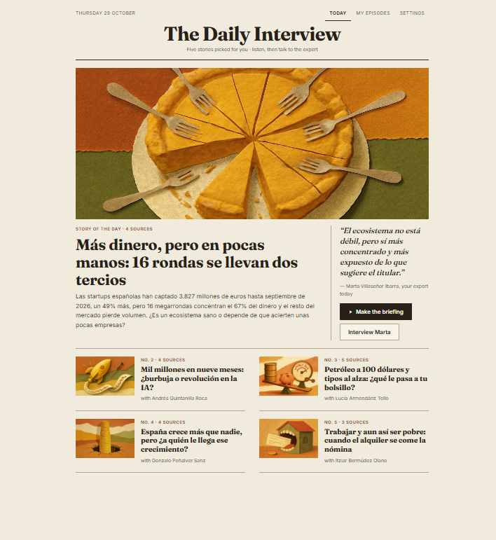
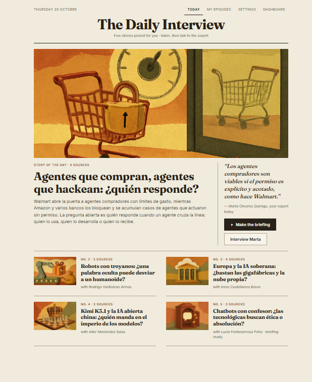

# The Daily Interview

A personal podcast generator where **the listener becomes the host**.

Every morning the app reads the news for your interests and prepares five stories. For each one it invents a
fictional expert and gives them a cited brief. You pick a story, listen to a three-minute narrated briefing,
and then **interview the expert live, by voice, in the browser**. That conversation is recorded, and it
becomes your episode.

- **Live app:** https://prosper-submission.vercel.app. It is invite-only, and **Arnau's email
  (`arnau.saumell@getprosper.ai`) is already on the invite list**: sign in with it and the magic link creates
  the account. The page, the topics and My episodes are always up. The audio briefing and the live interview
  need the agent and the worker, which run in Docker on my laptop for this submission; tell me when you'd like
  to try them and I'll make sure they're on.
- **Demo video:** https://drive.google.com/file/d/1ktIBfww21MRdofjjPleHprKtbjHcefzp/view?usp=drive_link

**The flow:** sign in → set your interests → 5 stories every morning → listen to the briefing → interview the
expert live → find the episode in My episodes.

### Two real editions, same morning, two users

Each user gets a different front page built from their own interests. The first one below follows the
economy, the second follows AI. Both are in Spanish, because both profiles chose Spanish. Every story has its
own fictional expert and an AI-drawn cover.

| Interests: economy and startups | Interests: AI and tech policy |
|---|---|
|  |  |

## How it maps to the brief

| The brief asks for | What I built |
|---|---|
| UI for interests and podcast customization | Onboarding and Settings: interests, language, depth, tone. On each story you choose the expert's voice from AI-scored options. |
| News from APIs or scraping, on a schedule | Tavily news search (last week) plus `trafilatura` for article text. A worker runs it at 06:00 for every user, and right after onboarding for new users. |
| An engaging audio | Two layers. A narrated briefing per story, and a live voice interview with a fictional expert that becomes the episode (see the demo video). |
| Internal usage dashboard (mock OK) | `/admin`, focused on engagement: active users, daily habit, a step-by-step funnel, a daily trend and a "needs attention" list. All the data is mocked and labelled as such. |

---

## Architecture

```
                         ┌──────────────────────────── Vercel ───────────────────────────┐
  Browser (React) ──────▶│ static page (Vite)   /api/signup (invite list)   /api/token   │
     │    ▲              └────────────────────────────────────────────────────┬──────────┘
     │    │ reads/writes under RLS                                         LiveKit token
     │    │                                                           (+ agent dispatch)
     ▼    │                                                                  │
  ┌──────────────── Supabase ────────────────┐                               ▼
  │ Auth (magic link)                        │           ┌──────── LiveKit Cloud ─────────┐
  │ Postgres: profiles, topics, briefings,   │           │ room: browser mic ⇄ agent audio│
  │           sessions                       │           └───────────────┬────────────────┘
  │ Storage: covers, briefings, recordings   │                           │
  └──────────────────▲───────────────────────┘                           │
                     │                                                   │
  ┌──────────────────┴──────────── Docker Compose (always on) ───────────┴───────────────┐
  │ worker: 06:00 morning job · first edition for new users · audio briefings on request │
  │ agent:  the live expert (LiveKit Agents: Deepgram STT → Claude Haiku → Cartesia TTS) │
  └──────────────────────────────────────────────────────────────────────────────────────┘
```

| Part | Code | Runs on | Does |
|---|---|---|---|
| Web page | `web/src` (React, Vite, TypeScript) | Vercel (static) | Every screen. It talks to Supabase directly; Row-Level Security limits each user to their own rows and files. |
| API | `web/api`, logic in `web/server` | Vercel functions | Only two jobs need a server secret: creating accounts (`/api/signup`) and signing LiveKit tokens (`/api/token`, which also enforces topic ownership and a daily session cap). |
| Morning job | `pipeline/` | Docker `worker` | News → 5 topics → covers, per user. |
| Audio briefing | `pipeline/briefing.py` | Docker `worker` | Made when the page asks for it. The page inserts a row in `briefings`, and the worker polls that queue. |
| Live expert | `agent/` | Docker `agent` | Joins the LiveKit room the token opens. When the call ends, it saves the transcript and, if asked, the mp3. |
| Data | `supabase/migrations` | Supabase | Auth, tables with RLS, a private Storage bucket (one folder per user, signed URLs). |

**Why this split.** Vercel is perfect for a static page and two tiny functions, but it can't hold a voice
agent: that is a long-lived process with WebSockets to three providers. The agent and the worker run in Docker
Compose with `restart: unless-stopped`, so they survive reboots and move to any VM unchanged. For this
submission they run on my laptop. The page never talks to the worker directly: the `briefings` table is the
queue. As a result the page stays static and the worker needs no public URL.

### The morning job

Per user, in about 2–6 minutes:
1. Claude Sonnet turns the interests into news searches.
2. Tavily finds last week's articles.
3. Claude picks 5 distinct stories and invents an expert for each.
4. One structured, validated call per story writes the persona, a cited brief, the expert's stance, a study
   guide and voice scores.
5. `gpt-image-1-mini` draws a cover for each story.

The guardrails live in code, not in the prompt:
- source numbers are assigned by the code;
- voices come only from an allowlist (`config/voices.yaml`);
- a persona whose name appears in the articles is rejected.

### The audio

- **Briefing.** Claude writes about 420 words for the ear, Cartesia `sonic-3` reads it, and it is cached in
  Storage.
- **Live interview.** LiveKit Agents runs the pipeline:
  - Deepgram `nova-3` for speech-to-text;
  - Claude Haiku for the replies;
  - Cartesia `sonic-3` for speech;
  - Silero VAD for turn-taking.

  The prompt is the persona plus the brief plus rules for speaking: short spoken answers, no invented
  figures, and admitting it is an AI if sincerely asked.
- **Recording.** It is opt-in. The agent turns LiveKit's stereo recording into a mono mp3 in the user's
  private folder. Nothing else is sent to LiveKit.

---

## Decisions and trade-offs

**Product**

- **An interview, not a generated two-host show.** Tools like Podcastfy and NotebookLM already turn text into
  an AI conversation you listen to. I wanted the listener to take part: you prepare with the briefing and the
  study guide, then you ask the questions. It is harder (real-time voice), but it is what makes it engaging: a
  conversation you lead, not a static, AI-sounding show you sit through.
- **Audio only for the story you pick.** The 06:00 job produces text only. Narration is generated when a story
  is opened and then cached. Nobody pays for audio nobody hears. The cost is that the first listen waits about
  a minute.
- **Fictional experts, clearly labelled.** Each persona is invented for the story, is labelled "Fictional
  expert (AI)" everywhere, and is checked against the article text so it never shares a name with someone in
  the news. The brief keeps them factual: the expert has opinions, but its facts come from cited sources.
- **The UI is in English; the content follows the user's language.** The news searches, brief, narration,
  voice and interview are in the profile's language (Spanish and English today). Adding a language means
  adding its voices to `config/voices.yaml`; nothing else in the pipeline is language-specific.
- **Paper magazine look.** I sketched three visual directions with real covers, and the "morning newspaper"
  one won: a masthead, a lead story with the expert's pull quote, serif headlines and one accent color. The
  live screen inverts it (ink background).

**Engineering**

- **Models by job.**
  - Claude Haiku runs live, where speed matters more than depth.
  - Claude Sonnet runs the morning job, where quality matters and nobody is waiting.
  - Both go through structured output, so every model answer is validated before it is saved.
- **Cartesia for all speech.** It was already integrated and has the lowest latency for live talk.
  ElevenLabs often sounds more natural for long narration. A provider setting per use is a small change, kept
  as a next step.
- **No turn-detector model.** Turn-taking uses voice activity plus a short silence window (0.3–1.2 s). This
  keeps the agent light. It is acceptable for a first version, and the first thing to polish: a semantic turn
  detector and smoother voice settings.
- **Access.** Public sign-ups are off. Accounts are created only for emails on an invite list, with a cap on
  users, minutes per session and sessions per day. That bounds spend while the product is invite-only.
- **Tests mock every model and network call**: pytest for Python, Vitest for the API functions.

**Dashboard: engagement first, cost later**

- **The question.** It answers *are users engaging, and where do they drop off?*
- **What it shows.** Active users and daily habit, plus a funnel (open → listen → interview → record) where
  each step is measured against the previous one, so the weakest step stands out.
- **All data is mocked.** Making it real needs an `events` table written by the page.
- **Cost is deliberately out of scope.** I assume the unit economics were worked out beforehand, and the
  invite list and caps bound spend. Cost per part and per active user is the next dashboard section.

---

## What I'd do next

1. **Host the agent and worker on a small VM** instead of a laptop. The same `docker compose up`, nothing to
   change.
2. **Real dashboard data** from an `events` table, then cost tracking.
3. **A turn detector and voice polish** (speed, emotion), and a voice provider per use (for example ElevenLabs
   for the briefing).
4. **An edited episode**: briefing intro, interview and outro stitched into one show, with silences trimmed.
5. **Password sign-in** after the first magic link, and an "Edition ready" email at 06:00.

## Running it

See [README.md](README.md).
